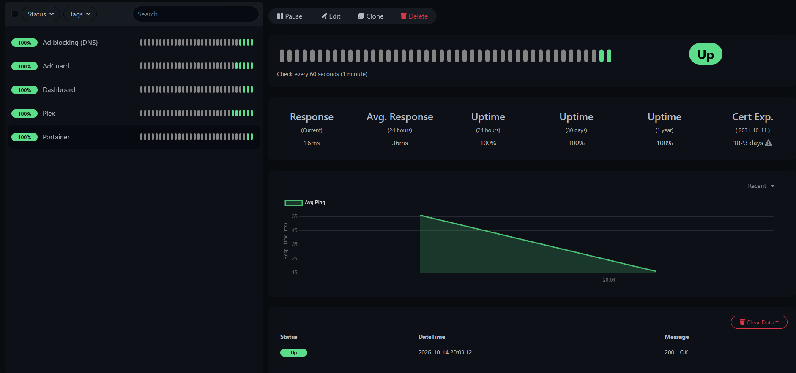
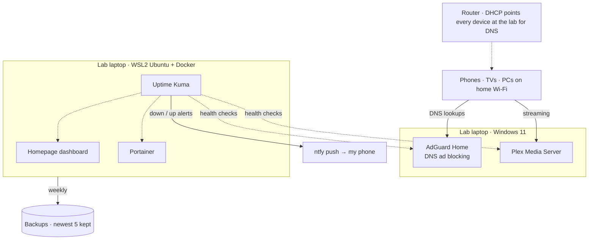

# Home Lab: Self-Hosted Services, Security Hardening & Monitoring

I turned a spare 8 GB Windows laptop into an always-on home server. It runs media streaming, whole-house ad blocking, container management, uptime monitoring with phone alerts, and automated backups. Then I audited it like a production system and fixed what I found.



## At a glance

| | |
|---|---|
| **Hardware** | Lenovo laptop: Ryzen 5 5500U, 8 GB RAM, 256 GB SSD, Windows 11 Home |
| **Platform** | WSL2 (Ubuntu) + Docker Engine + Docker Compose, with no Docker Desktop to save about 2 GB of RAM |
| **Services** | Plex Media Server, AdGuard Home (network-wide DNS ad blocking), Homepage dashboard, Portainer, Uptime Kuma |
| **Security work** | Read-only security audit → prioritized findings → scripted fixes → verified results |
| **Operations** | Auto-start on boot, uptime alerts to my phone (ntfy), weekly automated backups with retention |
| **Automation** | Every step is a PowerShell/Bash script that logs its output, so the whole build is repeatable |

## Why I built it

I wanted hands-on experience with the things IT and cloud teams work on every day: Linux, containers, networking, DNS, firewalls, monitoring and backups. Practicing on something real that my household actually uses meant that when it broke, I had to fix it.

## Architecture



**Key design decisions**
- **Kept Windows and added Linux through WSL2** instead of wiping the laptop, because Plex already ran well on Windows.
- **Memory-capped the Linux VM** (3 GB + 4 GB swap) and limited each container to 256 MB so Plex and Windows stay responsive on 8 GB of RAM.
- **Ran AdGuard Home natively on Windows instead of Pi-hole in a container.** Packet capture showed WSL's networking was silently dropping DNS traffic from other devices (see [troubleshooting](docs/troubleshooting.md)).
- **Set DNS once at the router**, so every device in the house is protected without changing settings on each one.

## Security audit & hardening

I wrote a **read-only audit script** ([`13-security-audit.ps1`](scripts/13-security-audit.ps1)) that checks antivirus, firewall profiles and rules, listening ports, disk encryption, remote access, SMBv1, local accounts, startup items, container privileges and pending Linux updates. I then fixed the findings with a separate, reviewable script ([`14-hardening.ps1`](scripts/14-hardening.ps1)).

| Finding | Risk | Fix | Verified |
|---|---|---|---|
| 112 pending Ubuntu updates | High | Patched with `apt-get upgrade` | ✅ 0 pending |
| Firewall still allowed old Pi-hole ports (53, 8080) to Linux | Medium | Rebuilt the rule: only 3000/3001/9443, only from the home subnet | ✅ |
| Dashboard container down after a port conflict | Medium | Recreated the container, moved AdGuard admin to its own port | ✅ HTTP 200 |
| Monitoring couldn't reach Windows-hosted services | Medium | Tested first, then moved monitoring containers to host networking | ✅ 5/5 up |
| No backups of lab configuration | Medium | Weekly automated backup, keeps the newest 5 | ✅ |
| AdGuard config is admin-only, so it was missed by the backup | Low | SYSTEM-level task copies it for the backup | ✅ |

**Already in good shape:** Defender real-time protection on, BitLocker full-disk encryption, firewall on for all profiles, RDP off, SMBv1 off, built-in Administrator and Guest disabled, Windows updates current.

Full details, including accepted risks and next steps: **[docs/security-audit.md](docs/security-audit.md)**

## Monitoring & backups

- **Uptime Kuma** checks Plex, AdGuard (web and DNS), the dashboard and Portainer every 60 seconds and sends a push notification to my phone through **ntfy** when anything goes down or recovers. I tested it by stopping a container and confirming the down and up alerts arrived.
- **Weekly backup** ([`15-backup.ps1`](scripts/15-backup.ps1)) zips the Docker volumes, compose files, AdGuard config and Plex settings, and keeps the last 5 copies. It briefly stops the stateful containers so the database copies are consistent.

## What I learned (troubleshooting highlights)

1. **"It's listening but nothing arrives."** Pi-hole was running, but phones got no DNS answers. A 2-minute `tcpdump` captured **0 packets** on port 53, which proved the traffic never reached Linux. That changed the fix from "configure Pi-hole" to "change the architecture."
2. **Port conflicts:** AdGuard's setup wizard grabbed port 3000 and silently broke the dashboard. Fixed by giving each service its own port and documenting the port map.
3. **Container isolation cuts both ways:** containers couldn't see services running on Windows. I tested host networking in a throwaway container **before** changing production, so the change could be rolled back.

More: [docs/troubleshooting.md](docs/troubleshooting.md) · How to operate and restore it: [docs/runbook.md](docs/runbook.md)

## Repo contents

```
scripts/   PowerShell + Bash automation, numbered in build order
stack/     docker-compose.yml and dashboard config
docs/      security audit, troubleshooting log, runbook
images/    screenshots
```

## Skills demonstrated

Linux administration · Docker & Docker Compose · WSL2 · Windows Server-style administration (services, scheduled tasks, firewall) · DNS · Networking (DHCP reservations, subnets, ports) · Security auditing & hardening · Monitoring & alerting · Backup & recovery · PowerShell & Bash scripting · Root-cause troubleshooting · Technical documentation

---
*Built with AI-assisted scripting (Claude). I ran, tested, debugged and verified each step on real hardware.*
